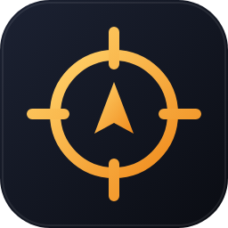
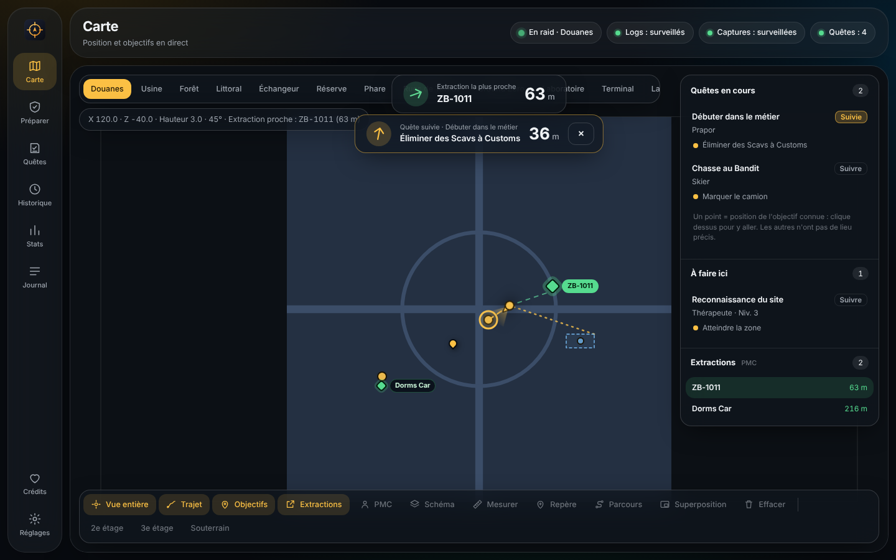
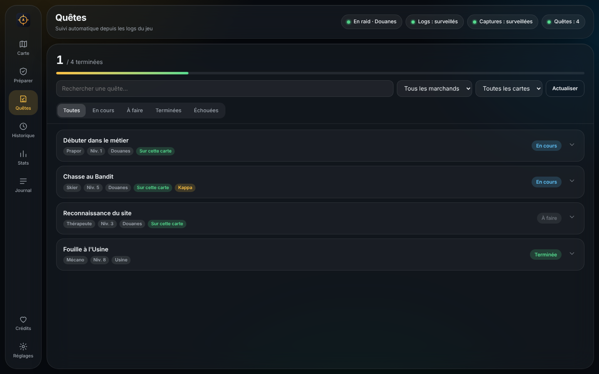
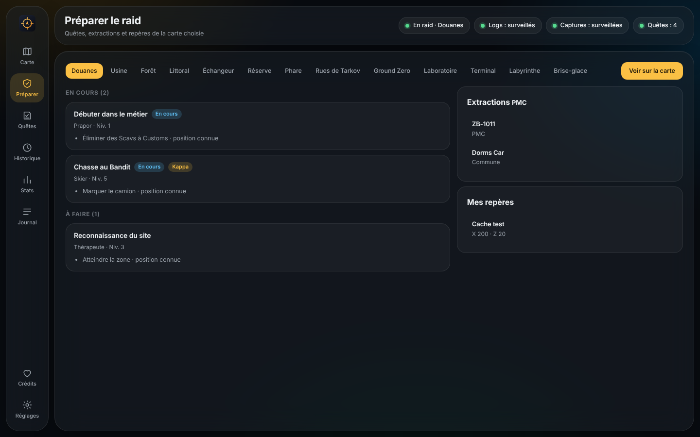
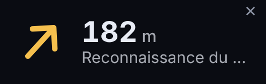

<div align="center">



# Tarkov Companion

**Ta position, tes quêtes et tes extractions sur la carte, sans toucher au jeu.**

[](https://github.com/sonnight10/TarkovCompanion/releases/latest)


[**Télécharger**](https://github.com/sonnight10/TarkovCompanion/releases/latest) · [Guide détaillé](docs/GUIDE.md) · [Historique des versions](CHANGELOG.md)

<br>



<sub>Captures avec des données de démonstration.</sub>

</div>

## Ce que ça fait

- 🗺️ **Carte interactive** : ta position (à chaque capture d'écran), ton trajet et les objectifs de tes quêtes en cours.
- 🧭 **Flèche vers ton objectif** : suis une quête ou un de tes repères, et une flèche te montre la direction (relative à ton regard) avec la distance.
- 🪟 **Mini-fenêtre** : une toute petite fenêtre séparée (flèche + distance + nom) qui reste au-dessus du jeu, déplaçable (touche **G**).
- ✅ **Quêtes automatiques** : lues dans les logs du jeu, rien à cocher à la main.
- 🚪 **Extractions** de ton camp (PMC ou Scav), avec la plus proche et sa distance.
- 🎒 **Préparer le raid** : quêtes à faire sur la carte choisie, extractions, repères.
- 📍 **Repères et mesure** : note tes caches et spawns, mesure une distance.
- 📊 **Historique et stats** : durée de tes raids, trajet rejouable, zones les plus visitées.
- 🔄 **Mises à jour** intégrées, vérifiées par empreinte SHA-256.
- 🎨 Thème sombre ou clair, 5 couleurs, français et anglais.

<div align="center">


</div>

<div align="center">
<br>


<sub>La mini-fenêtre, à taille réelle ×1,5.</sub>
</div>

## Installation

1. Va dans les [**Releases**](https://github.com/sonnight10/TarkovCompanion/releases/latest) et télécharge `TarkovCompanion-<version>.zip`.
2. Décompresse-le : il contient un seul fichier, `TarkovCompanion.exe`. Lance-le.
3. Windows peut afficher un avertissement SmartScreen (le logiciel n'est pas signé) : *Informations complémentaires* puis *Exécuter quand même*.

Dans Tarkov, mets l'affichage en **« Fenêtré sans bordure »** pour que la mini-fenêtre reste visible par-dessus le jeu.

<details>
<summary>Depuis les sources (Python 3.12 ou 3.13)</summary>

```
pip install -r requirements.txt
python main.py            # ou: python main.py --demo  pour essayer sans le jeu
```

Compiler l'exe : `build_exe.bat` (un seul fichier dans `dist/`), puis `python make_release.py`.
</details>

## Comment l'utiliser

1. Lance le logiciel : il trouve tout seul tes dossiers de logs et de captures d'écran (sinon : *Réglages → Parcourir*).
2. Lance un raid : la carte et l'état « en raid » sont détectés dans les logs.
3. Pour mettre ta position à jour, **prends une capture d'écran** avec la touche habituelle du jeu. Le logiciel lit la position écrite dans le *nom* du fichier.
4. Dans l'onglet *Quêtes*, clique sur **Suivre** : la flèche et la distance apparaissent, aussi dans la mini-fenêtre (**G**).

> La flèche et la distance se mettent à jour **à chaque capture d'écran**, pas en continu.

## Sécurité

Tarkov Companion est **en lecture seule** : il lit les fichiers texte des logs et les *noms* des fichiers de captures d'écran. Il n'injecte rien dans le jeu, ne lit pas sa mémoire, ne simule aucune touche et ne touche à aucun processus. Aucun outil ne peut garantir l'absence de risque avec un anti-cheat : tu l'utilises à tes risques.

## Contribuer

Les idées et les problèmes sont les bienvenus dans les [Issues](https://github.com/sonnight10/TarkovCompanion/issues). Si la détection du raid ou des quêtes ne marche pas chez toi, joins le *Diagnostic des logs* (*Réglages → Diagnostic*), sans y laisser d'informations personnelles.

## Crédits

- Calibration des cartes : [the-hideout/tarkov-dev](https://github.com/the-hideout/tarkov-dev) (MIT).
- Fonds de carte : [the-hideout/tarkov-dev-svg-maps](https://github.com/the-hideout/tarkov-dev-svg-maps), CC BY-NC-SA 4.0, téléchargés à l'exécution et non redistribués ici.
- Données de quêtes : API publique [tarkov.dev](https://tarkov.dev).
- [Leaflet](https://leafletjs.com) (BSD-2).

*Projet de fan, non affilié à Battlestate Games. « Escape from Tarkov » est une marque de Battlestate Games.*
